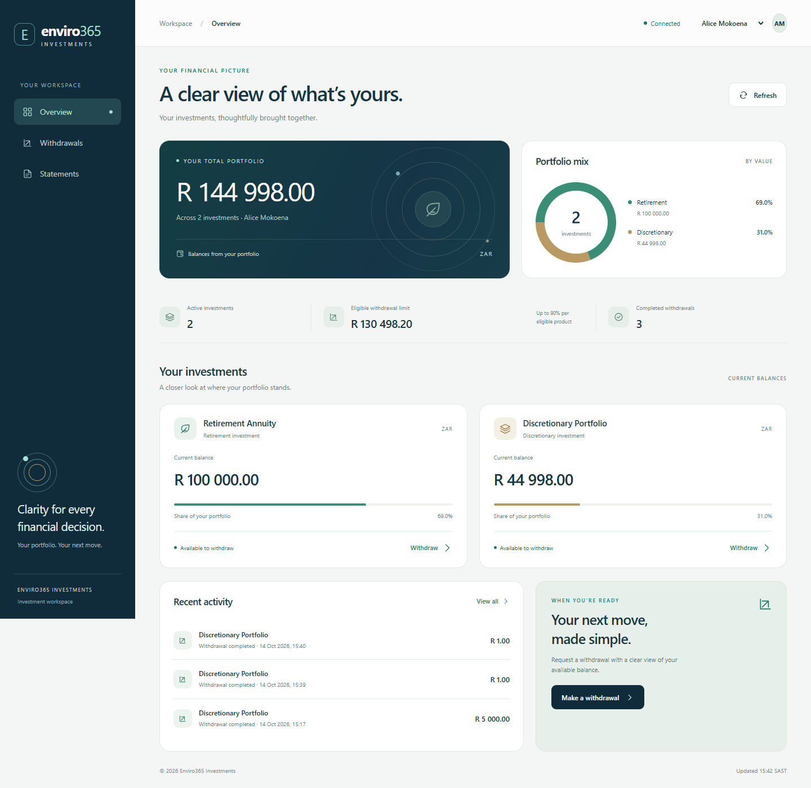

# Enviro365 Investment Portal

**Author:** Alex Motaung  
**Assessment:** Junior Software Developer — JSD2601  
**Repository:** [73CHMO/enviro365-junior-developer-assessment](https://github.com/73CHMO/enviro365-junior-developer-assessment)

A full-stack application for viewing investment portfolios, submitting withdrawal requests, reviewing withdrawal history, and downloading filtered CSV statements. The Java backend enforces financial rules and account ownership; the responsive frontend provides registration, sign-in, and a clear investment workspace.



## Features

| Area | Functionality |
| --- | --- |
| Portfolio | Investor details, investment balances, portfolio allocation, eligible withdrawal limits, and recent activity |
| Withdrawals | Product selection, amount validation, remaining-balance preview, confirmation, and immediate balance/history refresh |
| History | Completed withdrawal records ordered from newest to oldest |
| Statements | Inclusive date filtering, statement preview, totals, and downloadable CSV |
| Registration | South African ID validation, automatic date-of-birth entry, optional card Luhn validation, and masked account references |
| Authentication | JWT access tokens, rotating refresh credentials, sign-out revocation, and account ownership checks |
| Persistence | File-backed H2 storage for accounts, investments, and withdrawals |
| Interface | Responsive desktop/mobile layouts, loading and empty states, validation feedback, and service-error recovery |

Newly registered accounts start with an empty portfolio. The sample accounts below provide funded investment products for evaluating the withdrawal workflow.

## Technology stack

| Component | Technology |
| --- | --- |
| Backend | Java 21, Spring Boot 4.0.8 |
| Security | Spring Security, signed JWTs, BCrypt password hashing |
| Persistence | Spring Data JPA, Hibernate, H2 |
| Frontend | HTML, CSS, JavaScript modules |
| Frontend server | Node.js 22+; static files and a local API proxy |
| Backend tests | JUnit, Mockito, Spring Boot Test, MockMvc |
| Frontend tests | Node.js test runner and Playwright/Chrome |
| Build | Maven Wrapper and npm scripts |

Java base package: `com.enviro.assessment.junior.alexmotaung`.

## Project structure

```text
junior-developer-assessment/
├── backend/
│   ├── src/main/java/com/enviro/assessment/junior/alexmotaung/
│   │   ├── config/
│   │   ├── controller/
│   │   ├── dto/
│   │   ├── exception/
│   │   ├── model/
│   │   ├── repository/
│   │   ├── security/
│   │   └── service/
│   ├── src/main/resources/
│   ├── src/test/java/
│   ├── docs/Enviro365.postman_collection.json
│   ├── pom.xml
│   ├── README.md
│   └── SECURITY.md
├── frontend/
│   ├── index.html
│   ├── styles.css / auth.css
│   ├── app.js / auth.js / identity.js / money.js
│   ├── server.mjs
│   ├── tests/
│   ├── screenshots/
│   ├── package.json
│   └── README.md
├── LICENSE
└── README.md
```

Generated database files, local signing keys, build output, node_modules, and browser test artifacts are excluded from Git.

## Getting started

### Prerequisites

- JDK 21 with `JAVA_HOME` configured.
- Node.js 22 or newer.
- A current browser.
- Internet access for the first Maven dependency download.

Maven is included through the wrapper. The frontend requires no dependency installation to run; npm development dependencies are needed only for browser testing.

### 1. Start the backend

From the repository root, open a terminal:

```powershell
cd backend
.\mvnw.cmd spring-boot:run
```

On Linux/macOS:

```sh
cd backend
sh mvnw spring-boot:run
```

The backend listens on **http://localhost:8080**. Portfolio routes require authentication; opening an API URL without a bearer token returns 401.

### 2. Start the frontend

Open a second terminal from the repository root:

```powershell
cd frontend
npm.cmd start
```

On Linux/macOS, use `npm start`.

Open **[http://localhost:4200](http://localhost:4200)**. Use the local server rather than opening index.html directly. Frontend API requests are forwarded to the Java backend on port 8080.

Stop either service with Ctrl+C. If port 8080 is occupied, close the conflicting application before starting this backend; the frontend proxy expects that port.

### 3. Sign in or register

Select **Explore the demo portfolio** on the login screen to sign in as Alice, or enter one of these local sample accounts:

| Account | Email | Password | Portfolio |
| --- | --- | --- | --- |
| Alice Mokoena | alice@example.com | Enviro365!Demo2026 | Retirement and discretionary investments; age 70 |
| Thabo Nkosi | thabo@example.com | Enviro365!Demo2026 | Retirement and savings investments; age 65 |

These credentials are public demonstration credentials for sample data. Demo seeding is disabled under the production profile.

For a new account, choose **Create account**. Enter your name, email, password, and South African ID number. A complete valid ID fills the date of birth automatically; confirm the century and adjust it if necessary. The optional card field validates its checksum and retains only the last four digits. Registration processes no payment.

## Withdrawal rules

The backend validates every request against the current stored product balance:

1. The product must belong to the authenticated investor.
2. The amount must be positive, contain at most two decimal places, and fit the supported monetary precision.
3. Retirement withdrawals require an investor **strictly older than 65**.
4. The amount must not exceed the available balance.
5. The amount must not exceed **90% of the current product balance**.

For example, a product with R 100,000.00 permits a maximum withdrawal of R 90,000.00.

Money uses Java `BigDecimal` in the backend and integer cents with `BigInt` in the frontend. An accepted notice immediately reduces the balance and is recorded as `COMPLETED`. Product row locking and a database transaction keep the balance update and notice creation consistent under concurrent requests.

No bank transfer, external settlement, or approval workflow is performed.

## Authentication and sensitive data

- Access JWTs expire after five minutes and remain in browser memory.
- Refresh credentials rotate and use HttpOnly, SameSite=Strict cookies; production cookies additionally use Secure and host-only prefixes.
- Refresh-token hashes are stored instead of the original credentials.
- Logout and detected refresh-token replay revoke account credentials.
- Cookie-backed authentication requests require CSRF protection.
- Investment APIs enforce investor ownership and accept explicit bearer authentication.
- Passwords are BCrypt-hashed, and login/registration requests are rate-limited.
- Full ID and card numbers are not stored. The database retains an ID fingerprint, date of birth, and masked last-four references.
- ID, card, and password inputs are masked; account responses mask ID/card references and email.

ID and Luhn checks validate structure and checksum. They do not verify a person's identity, card ownership, or available funds.

The local application uses HTTP on localhost. Public deployment requires HTTPS, separate production secrets, protected storage, and appropriate trusted-origin/edge configuration. JWT authentication does not eliminate every credential-theft risk.

See [Security and storage documentation](backend/SECURITY.md) for the implemented controls, production requirements, and limitations.

## Data storage

The default database is stored at `backend/data/enviro365.mv.db`. Accounts, product balances, and withdrawal history survive restart.

Local development signing and identity-hash keys are generated or configured in `backend/data/.security-keys.properties`. This entire directory is ignored by Git. Do not publish these files or change the identity-hash key independently of its stored fingerprints.

The initial sample balances are seeded once. Browser workflow tests submit a real R 1.00 sample withdrawal, so demo balances change as tests and demonstrations are performed.

## API overview

| Method | Endpoint | Purpose |
| --- | --- | --- |
| GET | `/api/auth/csrf` | Prepare a CSRF token |
| POST | `/api/auth/register` | Create an account |
| POST | `/api/auth/login` | Sign in |
| POST | `/api/auth/refresh` | Rotate refresh credentials and renew access |
| POST | `/api/auth/logout` | Revoke account credentials and sign out |
| GET | `/api/auth/me` | Retrieve masked account details |
| GET | `/api/investors/{investorId}/portfolio` | Retrieve the authenticated investor's portfolio |
| POST | `/api/investors/{investorId}/withdrawals` | Create a withdrawal notice |
| GET | `/api/investors/{investorId}/withdrawals` | Retrieve withdrawal history |
| GET | `/api/investors/{investorId}/withdrawals/export` | Download a filtered CSV statement |

Withdrawal request:

```json
{
  "productId": 2,
  "amount": 5000.00
}
```

CSV export supports optional inclusive `from` and `to` ISO local date-times in Johannesburg time. An empty result still returns the CSV header. The frontend converts selected dates into complete-day boundaries, including fractional seconds.

For response examples and errors, see [Backend API documentation](backend/README.md). Import the [Postman collection](backend/docs/Enviro365.postman_collection.json) and run **Prepare CSRF** followed by **Sign in to demo account** before the investment requests.

## Testing

### Backend

Stop a backend running from the packaged jar before a clean build on Windows, because the process locks that jar.

```powershell
cd backend
.\mvnw.cmd clean verify
```

On Linux/macOS, use `sh mvnw clean verify`.

Verification covers **78 backend checks**: financial rules, validation, persistence and rollback, concurrent withdrawals, CSV filtering, authentication, ownership, token expiry/tampering, refresh replay, logout, ID/card checks, throttling, and production cookie hardening.

### Frontend

```powershell
cd frontend
npm.cmd run check
npm.cmd test
```

The **12 unit tests** cover exact monetary handling, date boundaries, ID/card validation, and automatic birth-date inference.

For browser tests, keep the backend running and install the frontend development dependencies:

```powershell
npm.cmd ci
npm.cmd run test:browser
```

The browser configuration uses an installed Google Chrome. **Eight browser scenarios** cover the signed-in investment workflow, actual CSV downloads, registration masking, session restoration, ownership, logout, multiple tabs, mobile layout, and error recovery.

## Screenshots

| Screen | Preview |
| --- | --- |
| Sign in | [Desktop](frontend/screenshots/login-desktop.png) |
| Registration | [Desktop](frontend/screenshots/register-desktop.png) · [Mobile](frontend/screenshots/register-mobile.png) |
| Portfolio | [Desktop](frontend/screenshots/overview-desktop.png) · [Mobile](frontend/screenshots/overview-mobile.png) |
| Withdrawals and history | [Desktop](frontend/screenshots/withdrawals-desktop.png) |
| Filtered statements | [Desktop](frontend/screenshots/statements-desktop.png) |

Screenshots were captured from the running application. Amounts reflect the sample data and completed demonstration requests.

## Assessment coverage

The solution includes both frontend and backend in one public repository. It implements portfolio retrieval, withdrawal processing, filtered CSV statements, H2 persistence, and all five advanced features: DTOs, input validation, global exception handling, tests, and UI validation.

Registration and JWT security extend the initial assessment scope. The original [Backend plan](backend/BACKEND_PLAN.md) and [Implementation status](backend/IMPLEMENTATION_STATUS.md) remain available for context.

Work is performed on local `alex`, promoted through `develop`, and published on `main`. Repository submission to the assessment portal is handled separately.

## AI Usage Disclosure

ChatGPT/Codex assisted with architecture planning, scaffolding, Java and JavaScript implementation, test development, interface design, documentation, and screenshot capture. Automated backend, frontend, and browser checks were run against the implementation.

## License

Licensed under the [MIT License](LICENSE). Copyright © 2026 Alex Motaung.
