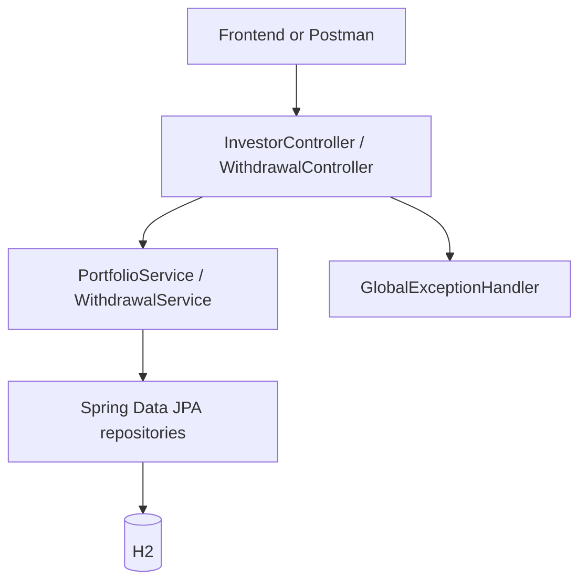

# Enviro365 Investment Backend

Author: Alex Motaung

Java 21 / Spring Boot 4.0.8 backend for the Enviro365 JSD2601 assessment. The base package is `com.enviro.assessment.junior.alexmotaung`. The implementation follows [BACKEND_PLAN.md](BACKEND_PLAN.md).

## Setup and execution

Install JDK 21 and set `JAVA_HOME` to that JDK. Maven is provided by the wrapper; the first build requires internet access to download dependencies.

Run these commands from the `backend` directory.

Windows PowerShell:

```powershell
.\mvnw.cmd clean verify
.\mvnw.cmd spring-boot:run
```

Linux/macOS:

```sh
sh mvnw clean verify
sh mvnw spring-boot:run
```

Alternatively, run the packaged application:

```sh
java -jar target/junior-developer-assessment-0.0.1-SNAPSHOT.jar
```

The API listens at `http://localhost:8080`. There is no HTML page at the root URL; use the API paths below. Stop the process with Ctrl+C.

If another application already uses port 8080, run the jar with `--server.port=8081` and use `http://localhost:8081` for API calls. Live verification passed on the default port 8080 after the conflicting application was closed.

## Seed data and database

H2 now uses persistent file storage under `backend/data` and JPA updates the schema. Accounts, balances, and notices survive restart. Database files and development security keys are ignored by Git. The original in-memory setup was replaced when registration and persistent storage were requested.

| Investor ID | Investor | Age | Product ID | Product type | Initial balance (ZAR) |
| --- | --- | --- | --- | --- | --- |
| 1 | Alice Mokoena | 70 | 1 | RETIREMENT | 100000.00 |
| 1 | Alice Mokoena | 70 | 2 | DISCRETIONARY | 50000.00 |
| 2 | Thabo Nkosi | 65 | 3 | RETIREMENT | 80000.00 |
| 2 | Thabo Nkosi | 65 | 4 | SAVINGS | 20000.00 |

Withdrawal history starts empty. Seed IDs apply to a fresh application database; tests create their own isolated data.

The H2 browser console is disabled by default. Seed data can be disabled using `--app.seed-data=false`. Configuration is in `src/main/resources/application.properties`.

## Architecture



- `config`: Java seed loader, frontend origins, and an injectable application clock.
- `controller`: the four REST routes and HTTP responses.
- `dto`: five request/response types; persistence entities never leave the API.
- `model`: Investor, Product, Withdrawal, and their enumerations.
- `repository`: ownership-scoped queries, statement filtering, and product locking.
- `service`: portfolio mapping, withdrawal business rules, transactions, history, and CSV generation.
- `exception`: consistent error responses.

An investor's products form their portfolio; no separate portfolio table is required. Products reference investors, and withdrawals reference their investor and product. Entities use lazy relationships; responses are mapped inside service transactions. Open Session in View is disabled.

## Business rules and transaction behavior

1. The request requires a positive product ID and an amount of at least 0.01, at most 17 integer digits, and at most two decimal places.
2. The investor must exist, and the product must belong to that investor.
3. A retirement product requires age strictly greater than 65; age 65 is rejected.
4. The amount must not exceed the product's available balance.
5. The amount must not exceed exactly 90% of its current balance.

Money uses `BigDecimal` and database `DECIMAL(19,2)`. Fractional cents are rejected. The exact 90% limit is compared without rounding upward; on a balance of 0.03, the largest permitted withdrawal is 0.02.

Accepted notices immediately deduct the amount and are stored with `COMPLETED` status. Balance modification and notice insertion share one transaction. A pessimistic product row lock is held through commit, so concurrent requests validate sequentially against the current balance. Failed requests do not change the balance or create a notice. Lock contention that times out returns 409 and can be retried.

This immediate deduction is the plan's documented assessment assumption; no bank transfer or external settlement is performed. A repeated successful POST creates another withdrawal; duplicate-request protection is outside this assessment scope.

## API contract

Investment endpoints require `Authorization: Bearer <access JWT>` and enforce account ownership. Sign in through the frontend, or follow the auth flow in [SECURITY.md](SECURITY.md). Cookies alone cannot authenticate investment requests. Portfolio email values are now masked.

All routes begin with `http://localhost:8080`.

| Method | Path | Successful response |
| --- | --- | --- |
| GET | `/api/investors/{investorId}/portfolio` | 200, portfolio object |
| POST | `/api/investors/{investorId}/withdrawals` | 201, created withdrawal |
| GET | `/api/investors/{investorId}/withdrawals` | 200, history array |
| GET | `/api/investors/{investorId}/withdrawals/export` | 200, CSV attachment |

### Portfolio

`GET /api/investors/1/portfolio`

```json
{
  "investor": {
    "id": 1,
    "firstName": "Alice",
    "lastName": "Mokoena",
    "email": "alice@example.com",
    "age": 70
  },
  "products": [
    {"id": 1, "name": "Retirement Annuity", "type": "RETIREMENT", "balance": 100000.00},
    {"id": 2, "name": "Discretionary Portfolio", "type": "DISCRETIONARY", "balance": 50000.00}
  ]
}
```

A known investor with no products receives an empty `products` array. An unknown investor receives 404.

### Submit a withdrawal

`POST /api/investors/1/withdrawals` with `Content-Type: application/json`:

```json
{"productId": 2, "amount": 5000.00}
```

Response (generated ID and timestamp are illustrative):

```json
{
  "id": 1,
  "productId": 2,
  "productName": "Discretionary Portfolio",
  "amount": 5000.00,
  "createdAt": "2026-10-14T15:00:00",
  "status": "COMPLETED"
}
```

The product balance becomes 45000.00. Send only the product ID and amount; the service obtains the balance, ownership, age, and timestamp itself.

### History

`GET /api/investors/1/withdrawals`

Returns withdrawal response objects in an array, newest timestamp first, then highest ID first for equal timestamps. A known investor without notices receives `[]`. Only that investor's notices are returned.

### CSV statement

`GET /api/investors/1/withdrawals/export?from=2026-10-01T00:00:00&to=2026-10-14T23:59:59`

- `from` and `to` are optional ISO local date-times.
- Each provided bound is inclusive. Omit both for all notices.
- Use local time in `Africa/Johannesburg`, matching generated `createdAt` values.
- A date-only string or malformed date returns 400; `from > to` returns 400.
- For a whole day with fractional-second timestamps, use an upper bound such as `2026-10-14T23:59:59.999999999`.
- Response: `text/csv;charset=UTF-8`, attachment `withdrawals-{investorId}.csv`.
- Empty results return the header row.
- Product names are quoted, embedded quotes are doubled, and commas/newlines are preserved. Formula-prefixed names receive an apostrophe for safe spreadsheet display.
- Records follow the same descending order as history.

```csv
id,investorId,productId,productName,amount,createdAt,status
1,1,2,"Discretionary Portfolio",5000.00,2026-10-14T15:00:00,COMPLETED
```

## Error responses

```json
{
  "timestamp": "2026-10-14T15:00:00",
  "status": 400,
  "error": "Withdrawal exceeds 90% of balance",
  "details": {}
}
```

Field validation errors populate `details`, for example `{"amount":"Amount is required"}`.

| Status | Meaning |
| --- | --- |
| 400 | Invalid fields, JSON, date/ID parameters, or withdrawal business rules |
| 404 | Unknown investor, missing/unowned product, or unknown endpoint |
| 405 | Unsupported HTTP method |
| 409 | Product lock could not be obtained; retry |
| 415 | Unsupported request content type |
| 500 | Unexpected failure; internal details are logged and not returned |

An unowned product uses the same 404 as a missing product. CORS rejection is handled by Spring's CORS processor and returns 403.

## PowerShell API walkthrough

For Postman, import [Enviro365.postman_collection.json](docs/Enviro365.postman_collection.json). Set its `baseUrl` variable to your backend address.

Start the application in another terminal, then run:

These examples now require JWT authentication. Import the Postman collection and run its CSRF and Sign in requests first, or use the frontend. The unauthenticated PowerShell commands below illustrate the paths and payloads; add `-Headers @{Authorization="Bearer $accessToken"}` using a token from the auth flow to execute them.

```powershell
$apiBase = 'http://localhost:8080/api/investors/1'
Invoke-RestMethod "$apiBase/portfolio"
Invoke-RestMethod -Uri "$apiBase/withdrawals" -Method Post -ContentType 'application/json' -Body '{"productId":2,"amount":5000.00}'
Invoke-RestMethod "$apiBase/withdrawals"
Invoke-WebRequest "$apiBase/withdrawals/export" -OutFile 'withdrawals.csv'
```

Try a retirement request for investor 2/product 3 to see the age restriction, or a request for 46000.00 on investor 1/product 2 after the successful withdrawal to see the insufficient-balance error.

## Frontend integration

CORS permits `http://localhost:4200`, `http://localhost:3000`, and `http://localhost:5173`. GET, POST, and OPTIONS are allowed; `Content-Disposition` is exposed so the UI can read download filenames.

Override origins with `--app.frontend-origins=http://localhost:4200` when running the jar. The frontend should refresh the portfolio and history after a successful withdrawal and display the returned `error` and field `details` on failure.

The adjacent `frontend` folder contains the completed responsive UI, login/register flow, frontend setup instructions, tests, and screenshots.

## Tests

`mvnw.cmd clean verify` runs unit tests and H2-backed HTTP/database integration tests.

- Portfolio mapping, missing investors, and empty portfolios.
- Retirement ages 64, 65, and 66.
- Exact 90%, excess balance, zero/negative/missing amounts, fractional cents, and precision limits.
- Product ownership and unchanged balances after rejection.
- Successful persistence and history ordering.
- Database failure rollback and concurrent withdrawal correctness.
- CSV inclusive and one-sided filters, empty exports, escaping, and formula prefixes.
- HTTP validation/error responses and frontend CORS.

Tests use a fixed clock where timestamp assertions require determinism. Integration fixtures are recreated for each test; demo seed data is disabled in that suite.

## Git workflow

`alex` is the local working branch. Promote tested changes to `develop`, push it, then promote `develop` to `main` and push. `develop` and `main` track their matching origin branches. Return to `alex` for further work.

## AI Usage Disclosure

ChatGPT/Codex assisted with architecture planning, Java implementation, tests, and documentation. Automated build and test results are documented in [IMPLEMENTATION_STATUS.md](IMPLEMENTATION_STATUS.md).

## Assessment assumptions

This is a local assessment prototype using sample investors and in-memory H2 storage. Age is stored as an integer as specified by the plan. Investor path IDs identify sample data without authentication. Accepted notices deduct balances immediately. Product classifications beyond RETIREMENT are illustrative.

JWT authentication and registration were added at the user's request after the initial plan; see [SECURITY.md](SECURITY.md). Investor/product CRUD, approval workflows, external payment integrations, and deployment infrastructure remain outside scope.
