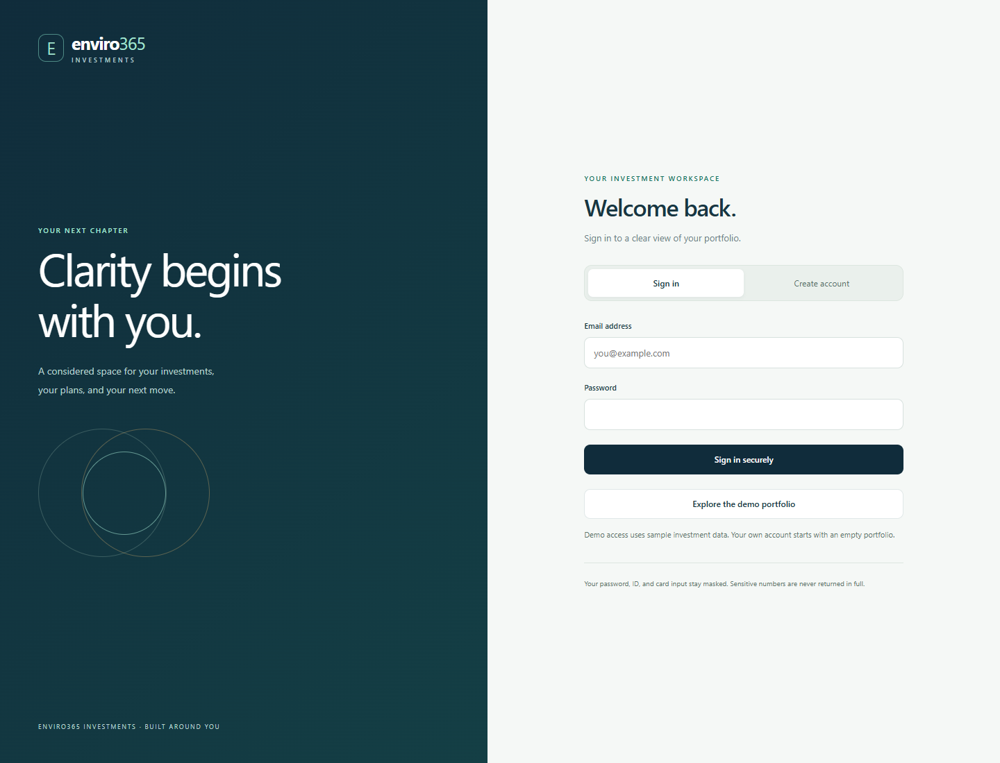
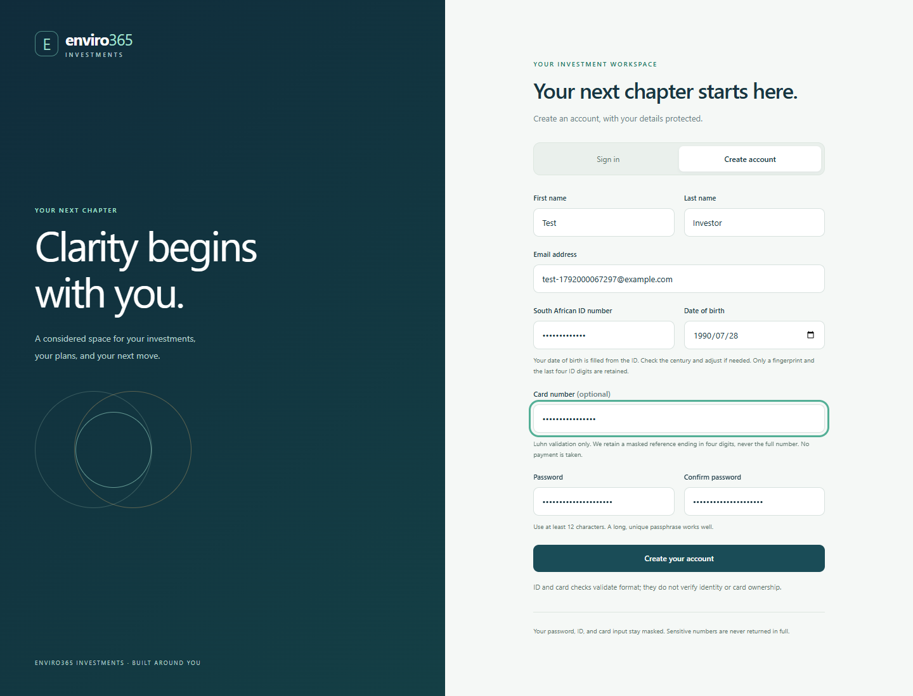
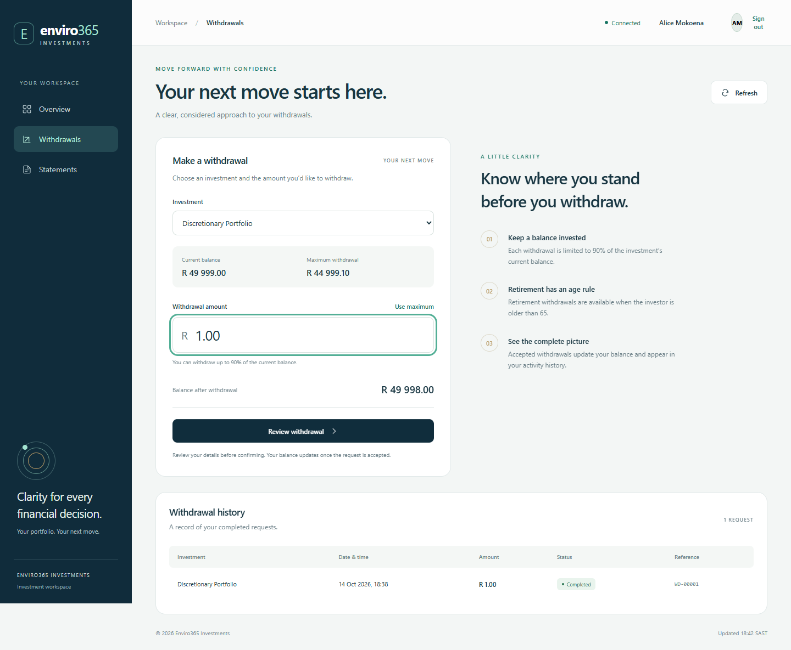
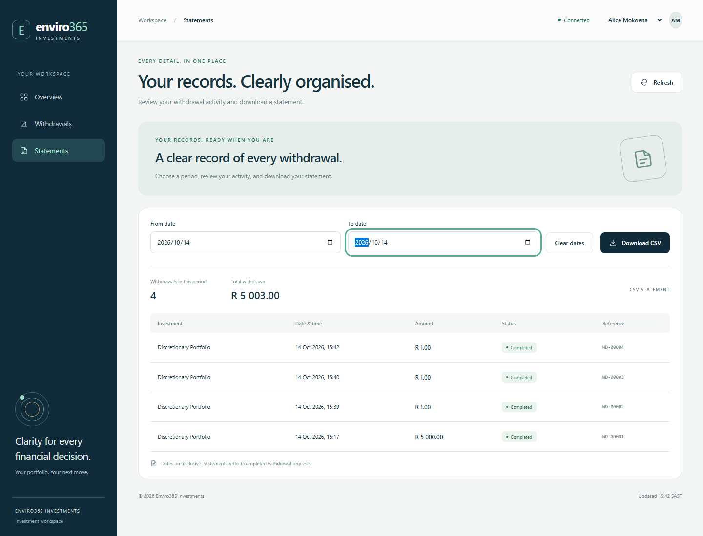
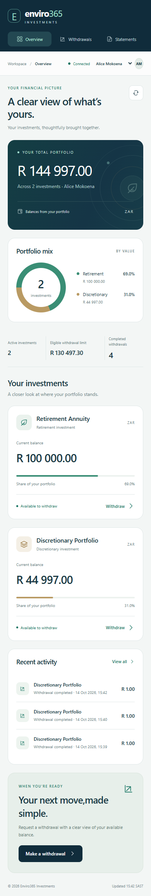

# Enviro365 Investment Frontend

Author: Alex Motaung

A responsive, professional investment workspace built with HTML, CSS, and JavaScript. All frontend source, server tooling, tests, and screenshots are contained in this folder. The Java backend remains in the adjacent `backend` folder.

## Design

Deep navy anchors the navigation, teal identifies eligible investments and primary actions, and muted gold distinguishes investment categories. A light neutral canvas, restrained typography, and generous spacing keep financial information easy to read.

The portfolio mix visualizes actual product balances. No market performance, growth figures, security certification, or investment returns are fabricated.

## Run the complete application

Requirements: JDK 21 for the backend and Node.js 22 or newer for this frontend. Use a current Chrome, Edge, Firefox, or Safari browser with modern JavaScript support.

Terminal 1, from the repository root:

```powershell
cd backend
.\mvnw.cmd spring-boot:run
```

Terminal 2, from the repository root:

```powershell
cd frontend
npm.cmd start
```

Open **http://localhost:4200**.

Sign in, create your own account, or select **Explore the demo portfolio**. A new registration starts with an empty portfolio. Existing portfolio, withdrawal, and statement screens retain their design. JWTs stay in memory; refresh cookies are HttpOnly. See [security and storage details](../backend/SECURITY.md).

Entering a complete, valid South African ID fills the date of birth automatically. It chooses the most recent valid date in the supported 120-year range. Because the ID contains only a two-digit year, confirm the century and edit the date if necessary; the backend still checks the match. Incomplete or invalid ID input clears an inferred date.

On Linux/macOS use `sh mvnw spring-boot:run` in the backend and `npm start` in the frontend.

No package installation is needed to run the frontend: its local server uses Node's built-in modules. Do not open `index.html` directly as a file; JavaScript modules and API requests need the local HTTP server.

The Java backend must be on port 8080. The frontend server serves static files and forwards only `/api/` requests to that local backend. It implements no investment logic or database operations. Both Java APIs and browser code remain in the same repository.

The frontend defaults to port 4200. To change its port in PowerShell:

```powershell
$env:PORT = '4201'
npm.cmd start
```

Stop the server with Ctrl+C.

## Features

### Portfolio dashboard

- Account-specific portfolios. Sign in as Alice or Thabo for the corresponding sample data; users cannot switch into someone else's portfolio.
- Current total portfolio balance and product balances.
- Portfolio allocation chart and per-product shares based on live balances.
- Product count, eligible withdrawal limit, and completed-withdrawal count.
- Recent withdrawal activity, eligibility feedback, and a shortcut to each product's withdrawal form.
- Loading, service-connection, empty-portfolio, and retry states.

### Withdrawals

- Select an investment and enter a ZAR amount.
- View the current balance, maximum withdrawal, and projected remaining balance.
- Reject fractional cents, zero/negative values, excessive amounts, and retirement requests when age is 65 or younger.
- Use the maximum permitted amount without rounding upward.
- Review investment, amount, and remaining balance in an accessible confirmation dialog.
- Submit the request to the Spring Boot API and refresh portfolio/history after success.
- Disable repeated confirmation clicks while submission is pending.
- Show service and validation errors without silently deducting a client-side balance.
- Complete withdrawal history, newest requests first.

### Filtered CSV statements

- Optional from/to dates with inclusive whole-day boundaries in Johannesburg local time.
- Reject reversed ranges with a visible message.
- Preview the matching records, record count, and total withdrawn.
- Download the real CSV generated by the backend, including its escaping and header row.
- Show useful empty and failed-download states.

## Financial precision

`money.js` converts monetary values to integer cents with `BigInt`. The 90% client limit rounds down to cents, matching the exact backend comparison. Request amounts are serialized as validated decimal JSON numbers without conversion to a floating-point number.

Modern `JSON.parse` source context preserves raw monetary response tokens before JavaScript number conversion. Current browsers support this feature; an older browser's fallback may lose precision for very large amounts, so use a current browser for this financial interface. The backend remains the final authority for all rules and balances.

Timestamps from the API are treated as local Johannesburg times and displayed in `Africa/Johannesburg`. Date filters include fractional seconds at the end of the selected day.

## Source structure

```text
frontend/
  index.html                 Accessible application shell and three screens
  styles.css                 Responsive navy/teal/gold design
  app.js                     Navigation, API integration, state, and interactions
  money.js                   Exact decimal validation and statement filtering
  favicon.svg                Local brand mark
  server.mjs                 Static server and local Java API proxy
  package.json
  package-lock.json
  playwright.config.mjs
  tests/
    money.test.mjs
    browser/frontend.spec.mjs
  screenshots/
    overview-desktop.png
    withdrawals-desktop.png
    statements-desktop.png
    overview-mobile.png
  README.md
```

## Verification

Syntax and precision/date checks:

```powershell
npm.cmd run check
npm.cmd test
```

Browser tests require development dependencies and an installed Google Chrome:

```powershell
npm.cmd ci
npm.cmd run test:browser
```

Keep the Java backend running on port 8080. Playwright starts the frontend server if needed.

**Important for the assessment sample data:** the live browser workflow submits a real R 1.00 withdrawal for Alice's discretionary product. H2 is now persistent, so restarting preserves balances and registered accounts. Screenshots are generated from real API data; amounts reflect previously completed demo/test requests. Do not delete the data directory to reset a demo if it contains accounts you want to keep.

Verified:

- Twelve precision, amount-rule, retirement-age, date-filter, South African ID, date-of-birth inference, and Luhn unit tests.
- Eight Chrome browser tests covering the signed-in withdrawal/CSV flow, age restrictions, mobile layout, service recovery, CSV errors, masked registration, logout, and multiple-tab refresh.
- Actual downloaded CSV contents were checked, not just a success toast.
- Desktop and mobile screenshots were visually inspected.

Additional browser scenarios verify masked registration, sign-in restoration after reload, no tokens in browser storage, cookie-only access rejection, account isolation, logout, and coordinated multi-tab refresh. Authentication screenshots are saved alongside the investment screenshots.

## Screenshots

### Sign in and registration





### Portfolio dashboard


### Withdrawal form and history



### Filtered statement workspace



### Mobile portfolio



## AI Usage Disclosure

ChatGPT/Codex assisted with frontend design, JavaScript implementation, tests, screenshots, and documentation. Automated checks and browser scenarios were run against the Java backend. Alex Motaung should personally review and understand the assisted implementation before submission and interview.

## Assessment completion status

The frontend requirements are implemented: portfolio dashboard, withdrawal form, history, filtered CSV download, and UI validation. This also adds UI validation to the backend's four implemented advanced features.

Backend setup, API documentation, business-rule assumptions, and backend AI disclosure remain documented in `../backend/README.md`. The MIT license at `../LICENSE` covers this frontend.

Before final submission, Alex still needs to review the assisted code, confirm the public `main` branch is accessible without sign-in, and submit the repository URL through the assessment portal before 14 October 2026 at 18:48. Login/registration, masked profiles, and persistent accounts are added as requested; see the backend security document for HTTPS and secret configuration.
